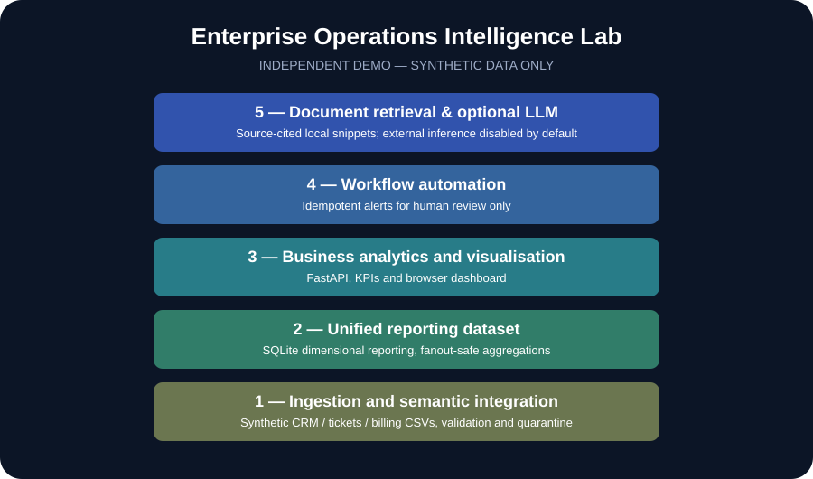

# Enterprise Operations Intelligence Lab

**Independent portfolio prototype · synthetic data only · not affiliated with any employer or client**

A reproducible five-layer, local decision-support demonstration for a fictional IT/telecom business. It combines generated CRM, service-ticket, and billing data into SQLite reporting datasets; exposes management KPIs through FastAPI and a browser dashboard; generates review-only alerts; and retrieves traceable policy and KPI documentation. External LLM synthesis is optional, disabled by default, and **not independently verified**.

> **Evidence boundary:** This is a newly created educational portfolio exercise, not evidence of prior deployment at DWP, Sapling, Moonpig, Accenture, or Unity World. CSV inputs simulate integrations; they are not live CRM/ERP API connectors. The project was prepared with AI assistance and must be reviewed and understood before being represented as personal work.

## KTP-aligned architecture

| Layer | Implemented capability |
|---|---|
| 1 — Data ingestion and semantic integration | Deterministic synthetic CSVs; schema, identifier, date, foreign-key validation and quarantine |
| 2 — Unified reporting dataset | SQLite reporting view with separately aggregated fact tables to avoid join fanout |
| 3 — Business analytics and visualisation | FastAPI KPI endpoints and an offline-friendly local dashboard |
| 4 — Business workflow automation | Deterministic, idempotent SLA and invoice alert candidates for human review only |
| 5 — AI and LLM capability | Grounded document retrieval with cited sources; optional OpenAI synthesis, off by default |



## Reproduce locally

Requires Python 3.10+.

```bash
python -m venv .venv
source .venv/bin/activate          # Windows: .venv\Scripts\activate
python -m pip install -e '.[test]'
python scripts/generate_synthetic.py
python -m opsintel.cli build
python -m opsintel.cli report
python -m opsintel.cli alerts
pytest -q
uvicorn opsintel.api:app --host 127.0.0.1 --port 8000
```

Then open **http://127.0.0.1:8000** (API docs: **/docs**). Do not expose the example service to the public internet.

## Evidence and limitations

- On the fixed sample dataset, local validation accepts 30 customers, 300 tickets and 240 invoices and quarantines 3 intentionally invalid records.
- The prior local run reported 7 passing tests. Run `pytest -q` to reproduce in your environment. Exact outputs are from synthetic data only.
- Snapshot date is fixed to 2026-10-25 for reproducible SLA and overdue-invoice flags.
- No live customer information, production integration, cloud deployment, SSO, RBAC, or audited GDPR compliance is included.
- Retrieving local excerpts alone does **not** constitute verified LLM reasoning or a production-grade RAG system.
- See [evidence and verification notes](docs/PROJECT_EVIDENCE.md) and [metric definitions](docs/knowledge/metrics.md).

## Suggested CV description

**Enterprise Operations Intelligence Lab — independent prototype using fictional data:** Built a Python/SQLite/FastAPI demonstrator integrating mock CRM, service and billing records; implemented validation/quarantine, fanout-safe KPIs, dashboard endpoints, deterministic review-only alerts and source-cited retrieval. Documented engineering trade-offs, test coverage and production-readiness limitations.

Do not present the synthetic results as genuine employer KPIs or the project as production deployed.
